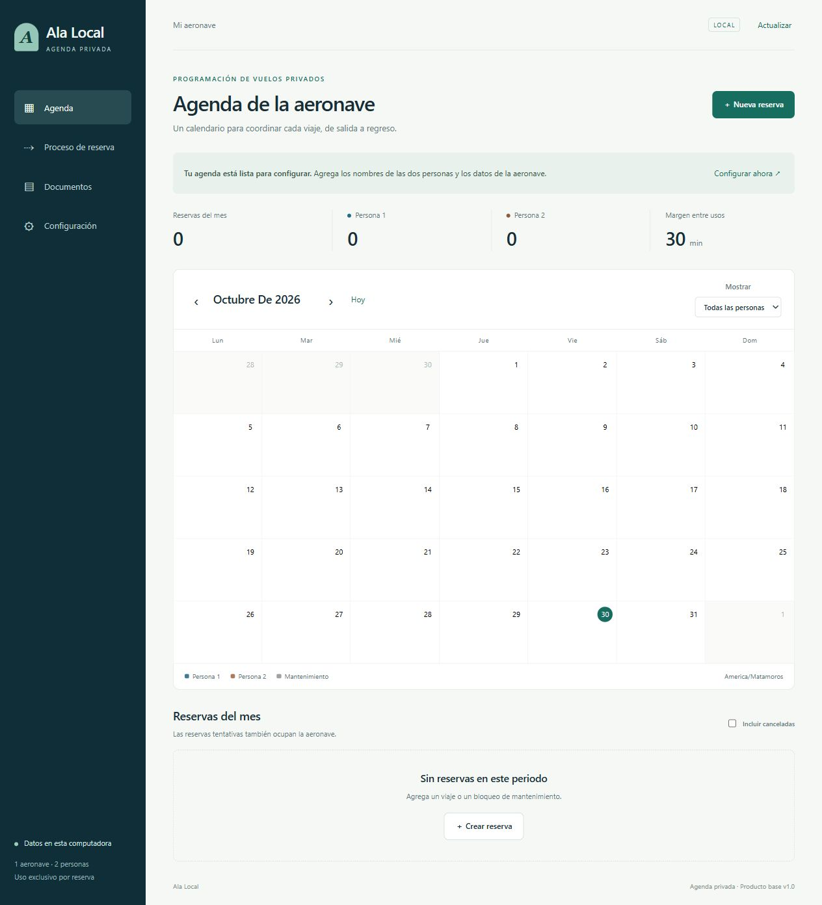

# Ala Local

Producto base para coordinar vuelos privados de **una aeronave y dos personas**, con uso exclusivo por reserva. Aplicación web local para una sola computadora. Interfaz en español.



## Qué incluye

- Calendario mensual y lista de reservas con filtros por persona y día.
- Creación, edición, confirmación y cancelación de reservas. Las canceladas se conservan y se pueden mostrar y reactivar.
- Bloqueo de cruces en el servidor, incluso al guardar desde dos ventanas.
- Bloqueos de mantenimiento y margen configurable entre usos.
- Nombres de las dos personas, matrícula, modelo, base y zona horaria configurables.
- Persistencia en SQLite e historial de cambios.
- Exportación por periodo y persona a PDF y PowerPoint editable (`.pptx`).
- Respaldos JSON y herramienta para restaurarlos.
- Diagrama de flujo en la sección **Proceso de reserva**.

## Instalación en Windows

Requisitos: **Python 3.11 o posterior**, **Node.js 20 o posterior** y acceso a internet solo durante la instalación de dependencias. Después, la aplicación y sus exportaciones funcionan localmente.

1. Descarga o clona este repositorio.
2. Abre PowerShell en la carpeta del proyecto y ejecuta:

   ```powershell
   powershell -NoProfile -ExecutionPolicy Bypass -File .\instalar.ps1
   ```

3. Abre `iniciar.cmd`. También puedes ejecutar `iniciar.ps1` desde PowerShell.
4. Visita **http://127.0.0.1:8877** y abre **Configuración** para introducir tus datos.

El servidor permanece activo al cerrar el navegador. Para detenerlo:

```powershell
powershell -NoProfile -ExecutionPolicy Bypass -File .\detener.ps1
```

Los scripts no cambian la política de ejecución permanente de Windows.

## Instalación manual / macOS / Linux

```bash
python -m venv .venv
# macOS/Linux: source .venv/bin/activate
# Windows PowerShell: .venv\Scripts\Activate.ps1
python -m pip install -r requirements.txt
npm ci --ignore-scripts
python server.py
```

Abre http://127.0.0.1:8877. `Ctrl+C` detiene el servidor en este modo. Para usar otro puerto: `python server.py --port 8878`.

`runtime.json` es una configuración opcional de rutas locales a Python y Node, creada por el instalador. No se sube al repositorio. Sin ese archivo, el servidor usa `node` del PATH.

## Reglas de reserva

1. Cada vuelo tiene exactamente una persona responsable. Los nombres identifican al titular del viaje, no al piloto ni al resto de los pasajeros.
2. El intervalo reservado comprende **todo el uso de la aeronave, incluido el regreso**. La fecha de liberación indica cuándo vuelve a estar disponible.
3. Tentativa, Confirmada y Completada ocupan el intervalo. Cancelada lo libera.
4. Se rechazan cruces de cualquier persona con cualquier vuelo o mantenimiento. No se permite sobreescribir una reserva ajena para resolver un conflicto.
5. El margen se aplica una sola vez entre dos usos. Por ejemplo, con 30 minutos de margen, una reserva que termina a las 13:00 permite otra desde las 13:30.
6. Las reservas usan instantes UTC en la base y se muestran en la zona IANA configurada. La interfaz rechaza horas inexistentes o ambiguas durante cambios de horario.
7. Las ediciones usan una versión para evitar perder cambios realizados desde otra ventana.

Esta versión administra la agenda. La validación operativa de la ruta, tripulación y aeronave se realiza fuera de la aplicación.

## Datos y respaldos

Los datos se guardan en `data/agenda.sqlite3`. La carpeta `data/`, los reportes generados, las dependencias instaladas y la configuración local están excluidos de Git. **GitHub conserva el código del producto, no las reservas personales.**

- Respaldo portátil: **Documentos → Descargar respaldo**.
- Restaurar ese JSON con el servidor detenido:

  ```bash
  python restore_backup.py ruta/al/ala-local-respaldo.json --replace
  ```

  El respaldo se valida en una base temporal antes de tocar la agenda. Si existe una base previa, se conserva una copia `data/antes-de-restaurar-*.sqlite3`.

- También puedes detener el servidor y copiar la carpeta `data/` completa a una ubicación segura. Para restaurarla, detén el servidor y reemplaza `data/` por esa copia.
- No edites ni compartas el archivo SQLite mientras el servidor esté activo.

## Desarrollo y pruebas

```bash
python -m pip install -r requirements-dev.txt
npm ci --ignore-scripts
python -m unittest discover -s tests -v
npm run test:js
```

GitHub Actions ejecuta los mismos controles. Los tests usan bases temporales, no la agenda del usuario. Consulta [la guía de entrega](docs/HANDOFF.md) y [la arquitectura](docs/ARCHITECTURE.md).

## Alcance de la versión base

Servidor enlazado únicamente a `127.0.0.1`, una computadora, una sesión compartida y dos titulares configurables. No incorpora autenticación, sincronización de datos entre computadoras, avisos externos ni publicación en internet. Para convertirla en un SaaS con varias cuentas hay trabajo adicional descrito en la guía de entrega.

Repositorio privado de trabajo. No se concede una licencia de distribución a terceros por defecto.
