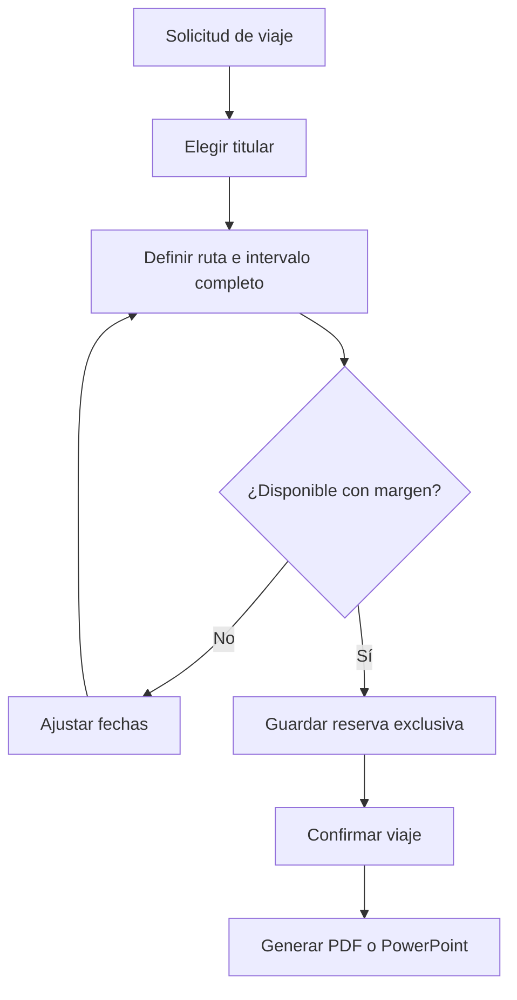

# Arquitectura y contratos

## Componentes

| Archivo | Responsabilidad |
| --- | --- |
| `server.py` | HTTP local, API, validaciones, transacciones SQLite y PDF con ReportLab |
| `static/index.html` | Estructura de la interfaz en español |
| `static/app.js` | Calendario, formularios, zonas horarias y descargas |
| `static/style.css` | Interfaz adaptable a escritorio y pantallas pequeñas |
| `export-presentation.mjs` | Exportación PowerPoint con PptxGenJS, sin servicios externos |
| `restore_backup.py` | Validación y restauración de JSON |
| `instalar.ps1`, `iniciar.ps1`, `detener.ps1` | Instalación y ciclo de vida local en Windows |

El navegador consume la API del mismo origen. No hay CDN, analítica, claves ni llamadas a servicios de aviación. PDF se genera en memoria. PowerPoint se genera en un directorio temporal de `data/` que se elimina al concluir la descarga.

## Modelo de datos

- `settings`: una fila JSON con la configuración y una versión de edición.
- `bookings`: titular `0` o `1`, tipo, ruta, intervalo UTC, estado, notas, versión y marcas de tiempo. Mantenimiento usa titular `NULL`.
- `history`: creación, edición y cambios de configuración. Conserva el detalle de la reserva en JSON. La interfaz muestra las últimas 30 acciones.

Los identificadores de reserva son 16 dígitos hexadecimales aleatorios. No hay borrado físico desde la interfaz.

## Exclusividad y concurrencia

Cada escritura comienza con `BEGIN IMMEDIATE`, valida versión y comprueba los conflictos antes de guardar. Si A es la reserva que se desea guardar y B una reserva existente:

```text
A.inicio < B.fin + margen
Y
A.fin + margen > B.inicio
```

La igualdad con el borde permitido no es conflicto. Una reserva cancelada no participa. La comprobación funciona en cualquier orden y para intervalos que contienen otros. Cambiar el margen vuelve a validar el calendario completo, incluidas reservas históricas.

SQLite usa WAL y un tiempo de espera de 15 segundos. Las conexiones se cierran explícitamente. Las reservas no dependen del estado que el navegador tenga en memoria.

## API

| Método y ruta | Respuesta |
| --- | --- |
| `GET /api/health` | Identidad y versión de la aplicación |
| `GET /api/state` | Configuración, reservas y actividad reciente |
| `POST /api/bookings` | Crear una reserva |
| `PUT /api/bookings/:id` | Editar incluyendo la versión leída |
| `PUT /api/settings` | Guardar configuración incluyendo la versión leída |
| `GET /api/report.pdf?from=YYYY-MM-DD&to=YYYY-MM-DD&person=all` | PDF de reservas que coinciden con el periodo |
| `GET /api/report.pptx?...` | PowerPoint con resumen, una diapositiva por reserva y notas completas en continuaciones |
| `GET /api/backup` | JSON completo, incluyendo historial |

`person` admite `all`, `0` o `1`. Un conflicto o una versión antigua responde `409`. Entrada inválida responde `400`. Las mutaciones requieren `application/json`. Las consultas están parametrizadas y el contenido del usuario se escapa antes de insertarse en HTML o PDF.

## Límites de seguridad y operación

Escucha solo en loopback y comprueba Host, Origin y solicitudes de origen cruzado. Sirve una lista fija de recursos estáticos. Los datos quedan bajo los permisos del usuario del sistema operativo. No existe aislamiento entre las dos personas que usan la computadora. No cambiar el enlace a `0.0.0.0` ni alojar este servidor en internet sin sustituir esa frontera de confianza.

## Flujo funcional


